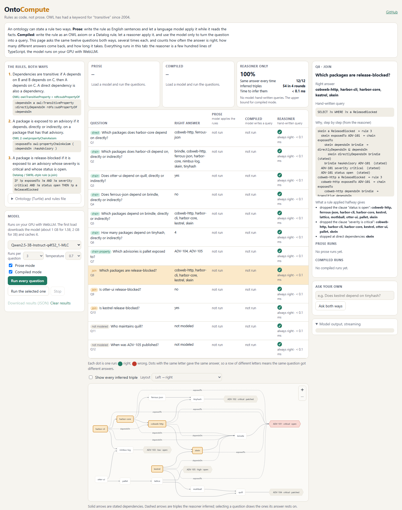
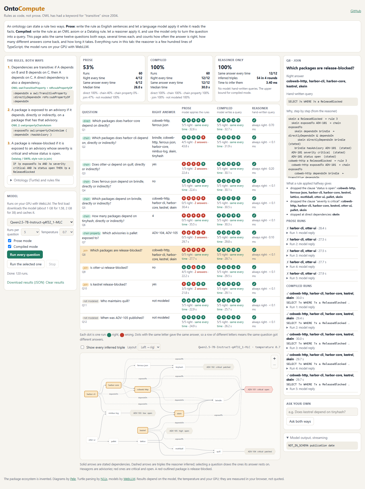

# Rules as Code, Not Prose: Letting an Ontology Compute Its Own Rules in a Browser Tab

*Inspired by Miodrag Cekikj, ["Give the Knowledge Layer Something to Compute: Foundry IQ and the Fabric IQ Ontology, Measured"](https://medium.com/p/56aea5e1549f), AI Advances, October 2026.*

## The problem

Ontologies are back in fashion, mostly as a source for language models. A team models its domain as classes, properties and facts, then hands that model to an assistant so it can answer questions with more than document snippets. The facts usually make the trip intact. The rules often don't.

A rule is the part of an ontology that produces new facts from old ones. "If A depends on B and B depends on C, then A depends on C." "A package is blocked if it is exposed to an advisory that is critical and open." In many current setups those rules are written as English sentences and placed in the prompt next to the facts. The language model is then expected to apply them: to follow every chain to the end, to check every clause of every condition, and to do it the same way each time someone asks.

That asks a model to be an inference engine. It can look like one on easy cases. It fails on exactly the cases rules exist for: long chains, conditions with more than one clause, and counts over sets it had to build itself. It also fails differently from run to run, so a team testing the assistant once may never see the problem.

There is an older way to state a rule. OWL has had `owl:TransitiveProperty` since 2004 and property chains since OWL 2 in 2009. Rules with joins are what SWRL and Datalog were built for. A rule written that way is not read; it is run. A reasoner applies it to every fact, follows every chain to the end and checks every clause, and gives the same result every time.

OntoCompute puts the two approaches side by side in a browser tab, on the same facts and the same questions, so you can watch the difference instead of taking it on trust.

## A small world with three rules

The page holds an invented open-source package ecosystem. It is small enough to check by hand and deep enough to need real inference: 14 packages, dependency chains up to four hops long, and five security advisories, each with a severity and a status.

A few of the stated facts:

- harbor-cli depends directly on harbor-core and nimbus-log.
- harbor-core depends directly on cobweb-http and ferrous-json.
- cobweb-http depends directly on skein and tinyhash; skein depends directly on brindle.
- otter-ui depends on pallet, which depends on lattice, then mothball, then quill.
- Advisory ADV-101 is on brindle. It is critical and open.
- Advisory ADV-104 is on quill. It is critical but patched.

Three rules sit on top of the facts:

| # | In English | As code |
|---|---|---|
| 1 | Dependencies are transitive. A direct dependency is a dependency. | `:dependsOn a owl:TransitiveProperty` and `:directlyDependsOn rdfs:subPropertyOf :dependsOn` |
| 2 | A package is exposed to every advisory on anything it depends on. | `:exposedTo owl:propertyChainAxiom ( :dependsOn :hasAdvisory )` |
| 3 | A package is release-blocked if it is exposed to an advisory that is critical **and** open. | `IF ?p exposedTo ?a AND ?a severity critical AND ?a status open THEN ?p a ReleaseBlocked` |

Each rule tests something different. Rule 1 is a chain: to know everything harbor-cli depends on, you have to walk four hops down to brindle. Rule 2 is a chain followed by one more step: walk the dependencies, then collect the advisories on everything you reached. Rule 3 is a join: two conditions on the same advisory, both of which must hold. An advisory that is critical but patched doesn't count, and neither does one that is open but low severity.

The world is built so that these rules have consequences. kestrel is release-blocked, but only through skein to brindle, two hops away. otter-ui is exposed to a critical advisory, ADV-104 on quill, four hops down, but that advisory is patched, so otter-ui is not blocked. A shortcut in any rule gives a different answer.

## Twelve questions, three ways to answer

The page asks twelve questions, each tagged by shape:

- **Direct lookup:** "Which packages does harbor-core depend on directly?"
- **Chain:** yes/no ("Does otter-ui depend on quill?"), list ("Which packages does harbor-cli depend on?"), reverse ("Which packages depend on brindle?") and count ("How many packages depend on tinyhash?").
- **Property chain:** "Which advisories is pallet exposed to?"
- **Join:** "Which packages are release-blocked?", "Is otter-ui release-blocked?", "Is kestrel release-blocked?"
- **Not modeled:** "Who maintains quill?" and "When was ADV-105 published?" The ontology has no maintainers and no dates, so the right answer is to say so.

Every question is answered three ways.

**Prose.** The facts and the three English rules go into the prompt, followed by the question. The model works out the answer and ends with a line that starts `ANSWER:`. This is the rules-in-plain-words approach.

**Compiled.** The model never sees the rules. It gets the schema (the property names, the classes, the package names) and a few examples, and its only job is to turn the question into a one-line query such as `SELECT ?x WHERE ?x a ReleaseBlocked`. A reasoner runs that query over every fact the rules imply.

**Reasoner only.** The same reasoner runs a hand-written query, with no model at all. This is the best compiled mode can do, and it is where the right answers come from. The test suite pins each of them against an answer worked out by hand.

The page can ask each question several times in each mode, each run a fresh conversation. For every question it shows how often the answer was right, how many different answers came back, and how long a run took.

Everything happens in the tab. The reasoner is a few hundred lines of TypeScript. The model runs on your own GPU through WebLLM. Nothing is sent to a server.

## How the compiled side works

The ontology is a plain Turtle file. When the page loads, each OWL axiom is compiled into a rule of one simple form: a few triple patterns in, one triple out.

- `TransitiveProperty` on `dependsOn` becomes: if `?a dependsOn ?b` and `?b dependsOn ?c`, then `?a dependsOn ?c`.
- `subPropertyOf` becomes: if `?a directlyDependsOn ?b`, then `?a dependsOn ?b`.
- The property chain becomes: if `?p dependsOn ?x` and `?x hasAdvisory ?a`, then `?p exposedTo ?a`.
- The join rule in the rules file already has this form.

`subClassOf`, `inverseOf` and `SymmetricProperty` compile the same way, so adding a new kind of axiom means writing one small translation.

The reasoner then applies every rule to every fact, adds whatever is new, and repeats until a pass adds nothing. In this world that produces 54 new triples in four passes and takes a few milliseconds. That is the slow, simple way to do it. It is still far faster than anything else in the loop.

While it works, the reasoner records how it first derived each triple. So every answer comes with a proof that goes all the way down to stated facts. Ask why kestrel is release-blocked and the page shows:

- kestrel is exposed to ADV-101, because kestrel depends on brindle and brindle has advisory ADV-101.
- kestrel depends on brindle, because kestrel depends directly on skein and skein depends directly on brindle.
- ADV-101 is critical and open (stated).
- So by rule 3, kestrel is release-blocked.

The model's query language is deliberately small. `SELECT` returns a list, `ASK` returns yes or no, `COUNT` returns a number, and patterns can be joined with a dot. One more form matters a lot: `NOT_IN_SCHEMA`. If the question needs something the ontology doesn't have, the model can say so, and the result is a typed answer, `NOT_IN_SCHEMA maintainer`. The page also checks every query against the schema. A query that uses a property, class or package that doesn't exist becomes the same typed answer instead of an error or an empty list.

That matters for whoever sits above the ontology. "Not modeled" is useful information: it tells the caller to try the documents instead. It should be a result the caller can act on, not an exception.

## Naming the missing step

When an answer is wrong, it helps to know why. OntoCompute works this out the same way it works out right answers: by running the reasoner.

For each question, the page builds a few broken versions of the world. In one, dependencies aren't transitive, so only direct dependencies count. In another, the join rule ignores the advisory's status. In a third, it ignores severity. It then runs the correct query on each broken world. Those results are the answers you get when a rule is applied halfway.

If a wrong run matches one of them, the page labels it: *stopped at direct dependencies*, *dropped the clause "status is open"*, *dropped the clause "severity is critical"*. A wrong answer stops being just wrong and becomes a specific step that was skipped. That is far more useful when deciding whether a fix belongs in the prompt, the model or the rules.

## The experiment

I ran all twelve questions five times each, in both prose and compiled mode, at temperature 0.7, on two models from the same family: Qwen2.5-3B and Qwen2.5-7B, both 4-bit quantised and running in Chrome on a laptop with an integrated Intel GPU. That is 120 runs per model and 240 in all. Each run is a fresh conversation, so nothing carries over from one run to the next.

Temperature 0.7 is a typical setting for an assistant. A lower temperature would reduce the variety of answers, but it wouldn't make a wrong rule right.

## What it showed

| | Prose | Compiled | Reasoner only |
|---|---|---|---|
| Qwen2.5-7B | 32 of 60 (53%) | 60 of 60 (100%) | 12 of 12 |
| Qwen2.5-3B | 30 of 60 (50%) | 39 of 60 (65%) | 12 of 12 |

Per question, for Qwen2.5-7B (right out of five):

| Question | Shape | Prose | Compiled |
|---|---|---|---|
| Which packages does harbor-core depend on directly? | direct | 5 | 5 |
| Which packages does harbor-cli depend on, directly or indirectly? | chain | 4 | 5 |
| Does otter-ui depend on quill, directly or indirectly? | chain | 1 | 5 |
| Does ferrous-json depend on brindle, directly or indirectly? | chain | 5 | 5 |
| Which packages depend on brindle, directly or indirectly? | chain | 0 | 5 |
| How many packages depend on tinyhash, directly or indirectly? | chain | 0 | 5 |
| Which advisories is pallet exposed to? | property chain | 0 | 5 |
| Which packages are release-blocked? | join | 0 | 5 |
| Is otter-ui release-blocked? | join | 4 | 5 |
| Is kestrel release-blocked? | join | 3 | 5 |
| Who maintains quill? | not modeled | 5 | 5 |
| When was ADV-105 published? | not modeled | 5 | 5 |

Grouped by shape, 7B prose got direct lookups and not-modeled questions right every time, chains 40% of the time, joins 47%, and the property chain never. Compiled mode got every shape right every time.

The larger model barely moved prose mode, from 50% to 53%. It moved compiled mode from 65% to 100%. Applying English rules is the hard part, and it stayed hard. Turning a question into a query is the easy part, and the larger model did it without a single mistake.

Speed was about the same in both modes for each model: around 13 seconds a run for 3B and 30 seconds for 7B. Almost all of that is the model reading its prompt. The reasoner takes under 4 milliseconds.

## What the wrong answers look like

The totals tell you that prose mode is unreliable. The individual runs tell you how.

**Consistent is not the same as correct.** On "which packages are release-blocked?" the 7B model gave the same wrong list, harbor-cli and otter-ui, in all five runs. The right answer is five packages, and otter-ui isn't one of them. On "how many packages depend on tinyhash?" it said 3 in all five runs; the answer is 4. A common way to test an assistant is to ask the same question several times and check that the answers agree. These answers agree perfectly and are wrong. Only an answer that is computed catches that.

**Long chains get cut short.** On "does otter-ui depend on quill?", four of the five prose runs said no. The page labelled each one *stopped at direct dependencies*. quill is four hops away, through pallet, lattice and mothball, and the model didn't walk that far. On "is kestrel release-blocked?", two runs said no for the same reason: the advisory is on brindle, two hops below kestrel. Prose mode handled one hop well. Each extra hop was another chance to stop early.

**Clauses get dropped.** On "is otter-ui release-blocked?", one prose run said yes. otter-ui is exposed to ADV-104, which is critical, but it's patched. That run matches the answer you get when the "status is open" clause is ignored. The join is the rule people most often write as a single English sentence, and it's the one most easily read halfway.

**Property chains were never right.** "Which advisories is pallet exposed to?" needs a walk down the chain followed by a lookup at every stop. Neither model got it right in prose in any of ten runs. The answers mixed advisories on the wrong packages with advisories on the right ones, and one run listed a package name as if it were an advisory.

**Compiled failures are visible.** The 3B model's compiled mistakes were all translation mistakes. It misspelled a package name. It wrote SPARQL-style FILTER and UNION clauses that the query language doesn't accept. It invented a "publishedOn" property. It turned "who maintains quill?" into "is quill release-blocked?". Every one of these is a one-line query you can read and see is wrong, and most of them produced no answer rather than a confident wrong one. A wrong prose answer is just a wrong list, with nothing to inspect except a long chain of reasoning.

To be fair to prose mode, there was one place where it did better. The 3B model said "not modeled" in prose for both not-modeled questions every time, but managed it through a query only 2 times in 10. A small model given a query language tends to write a query whether or not one makes sense. The 7B model had no such trouble.

## What this does and doesn't show

These are small models on a laptop, not the large hosted models teams use in production. A larger model will apply English rules more reliably, and a model that is allowed to reason at length may get further down a chain. The world is invented and small, and twelve questions in five runs each is a demonstration, not a benchmark.

What doesn't depend on the model is the shape of the trade. In prose mode, every part of the answer is up to the model: reading the facts, following the chains, checking the clauses, counting the result. Any of those can slip, and none of them can be inspected except by reading its reasoning. In compiled mode the model's job shrinks to one translation. Everything after that is done by code that can't drop a clause, can't stop a chain early and has no randomness of its own. Once the query is written, the answer is fixed, and the query itself is short enough to check.

That also changes what it takes to improve the system. To make prose mode better, you need a better model or a better prompt, and you find out whether it worked by running everything again many times. To make compiled mode better, you improve translation, which is a narrower task with a clear right answer that is easy to test.

## When to use which

Not every rule fits an axiom, and not every question needs a reasoner. A rough guide:

- **Use an axiom** for anything with a fixed logical shape: transitivity, inheritance between classes, inverse properties, property chains. These are cheap to state in OWL and reasoners handle them well.
- **Use a rules engine** for conditions that combine several facts, like the join here. Datalog and SWRL rules are short and easy to read once you have seen a few.
- **Leave it in prose** when the rule needs judgement rather than logic: "prefer a well-maintained package", "flag anything that looks unusual". A reasoner can't help there, and a language model can.
- **Make "not modeled" a result.** Whatever sits above the ontology should get a typed answer it can route on, not an error.

The pattern that comes out of this is a division of labour. The language model reads the person's question and writes a query. The reasoner does the chaining, the checking and the counting. The answer comes back with a proof, and the query that produced it is there to read.

## Why this is useful

- **For anyone building on an ontology:** if a rule can be written as an axiom, write it as an axiom. Use transitivity, property chains and a rules engine for joins. Let the language model turn a person's question into a query, and let the reasoner do the counting and the chaining.
- **For anyone evaluating a knowledge layer:** ask each question more than once, and also check the answers against computed ones. Repeated runs show whether an answer is stable. Only a computed answer shows whether it is right.
- **For anyone designing the "I don't know" path:** make "not modeled" a typed result, so the layer above can send the question to documents instead of failing.
- **For teaching:** the page shows each rule in English next to its OWL form, draws the inferred facts on the dependency graph, and gives a proof for every answer. It shows what "the ontology computes it" means.

## Try it

- Live: https://vishalmysore.github.io/ontoCompute/
- Code: https://github.com/vishalmysore/ontoCompute

Pick a model, choose how many runs per question, and press **Run every question**, or select one row and run just that question. You can also type your own question and see both modes answer it. The reasoner column, the proofs and the diagram work even in a browser without WebGPU. Results are measured in your browser and depend on the model, the temperature and your GPU. The raw results for both models used here are in the repository under `docs/results/`.

## Disclaimer

OntoCompute is a personal, independent project. It isn't affiliated with, endorsed by or connected to Miodrag Cekikj, Microsoft, or the makers of the models and libraries it uses; credit for the measurements that prompted it goes to Cekikj's article above. Every package, dependency and advisory in it is invented, and any resemblance to real software or real vulnerabilities is coincidental. The results come from small, quantised models running on one laptop, in a deliberately small world; they illustrate a pattern and are not a benchmark of any product or model. Nothing here is security advice. The views expressed are my own and not those of my employer.
